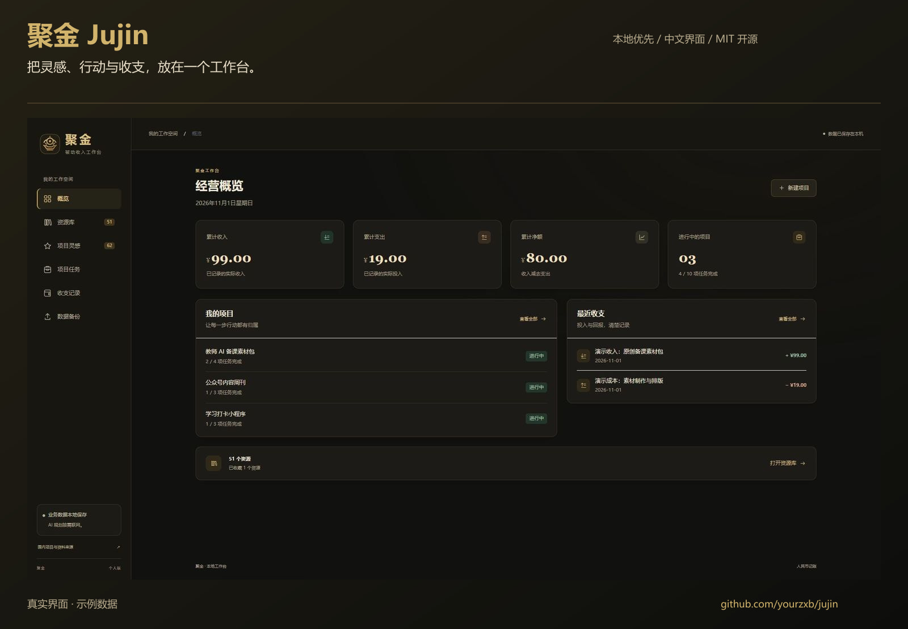
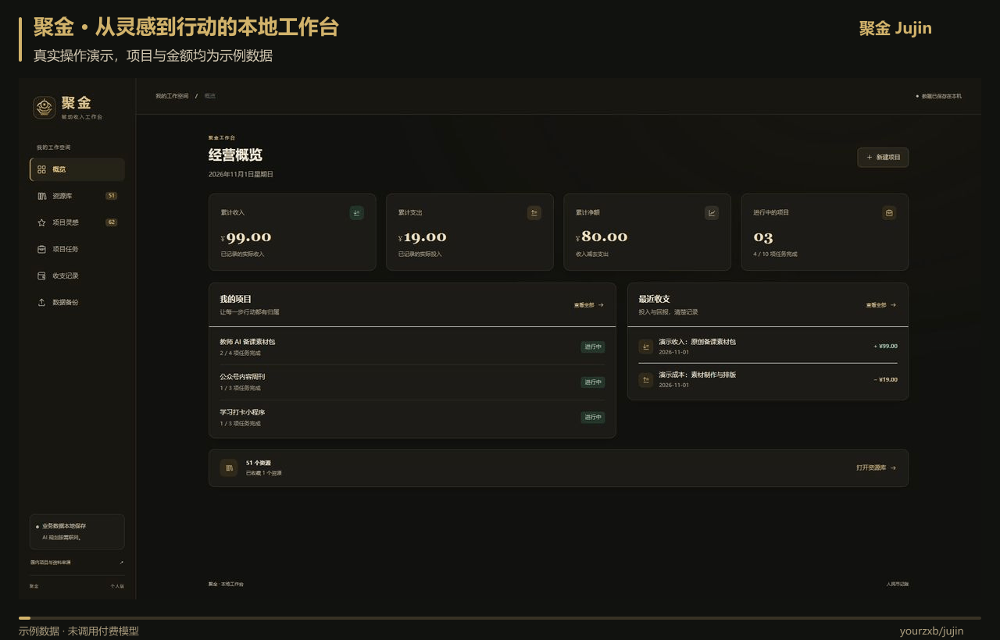
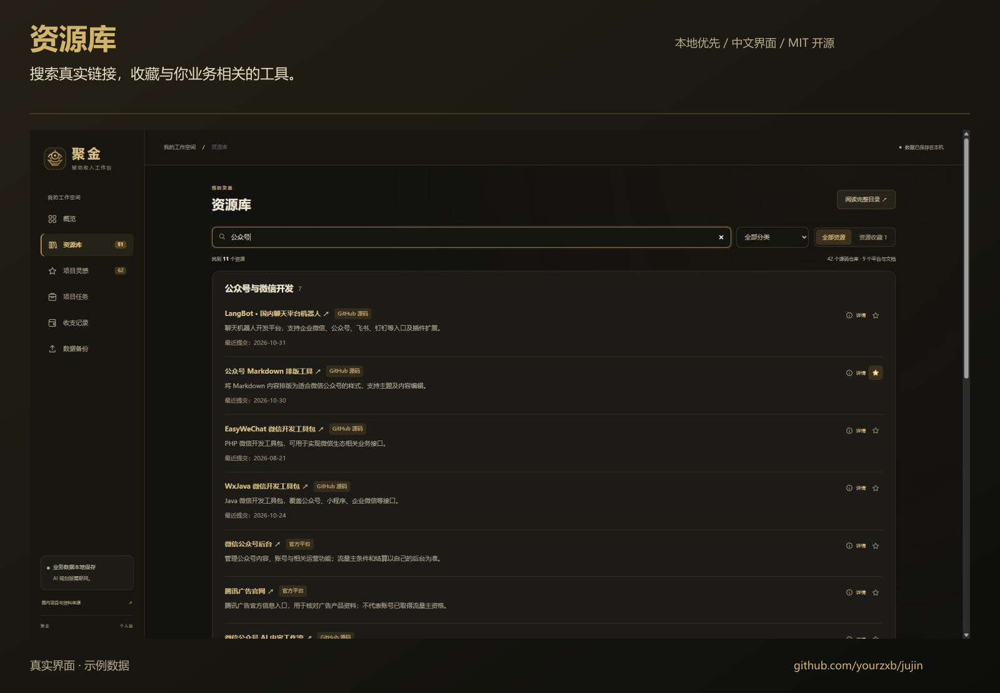
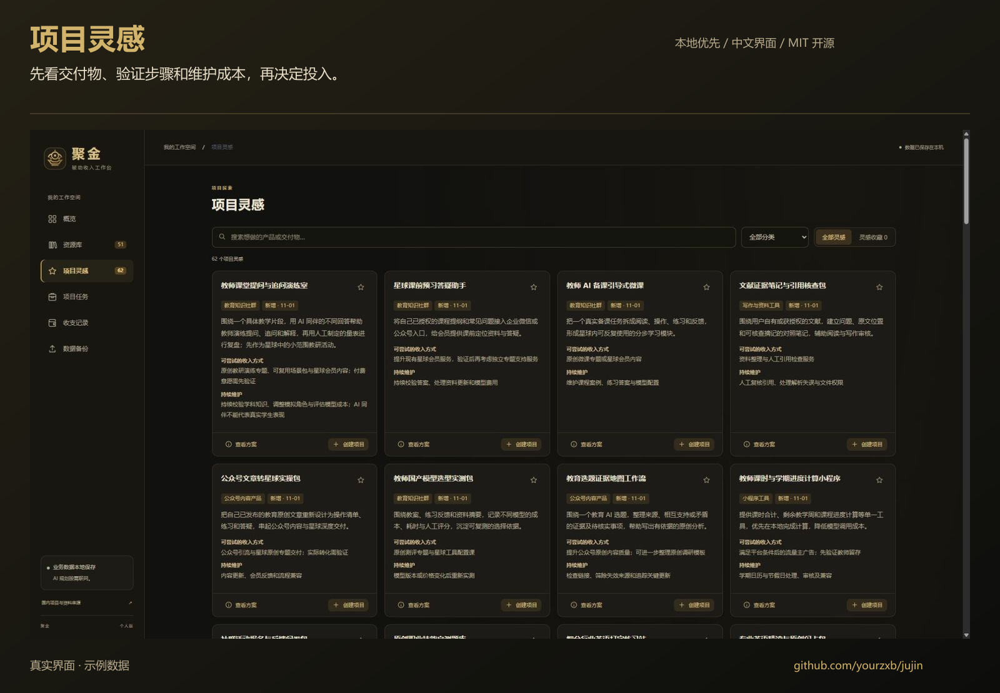
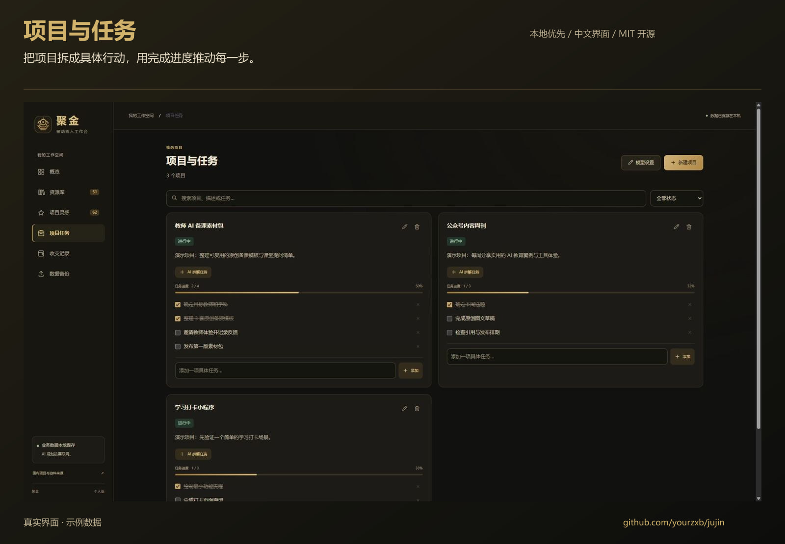
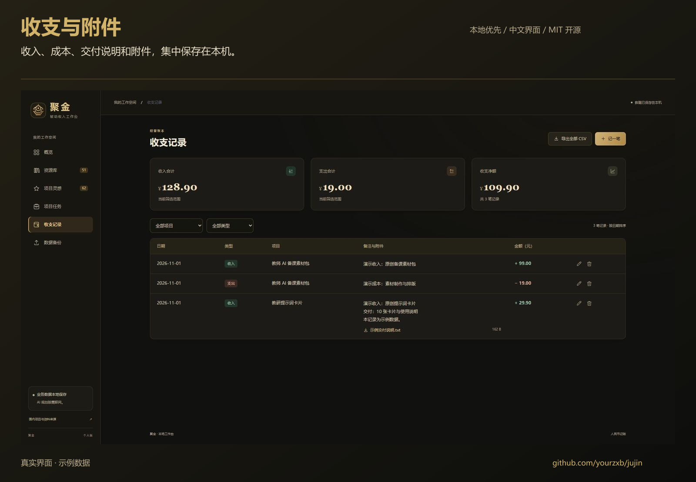
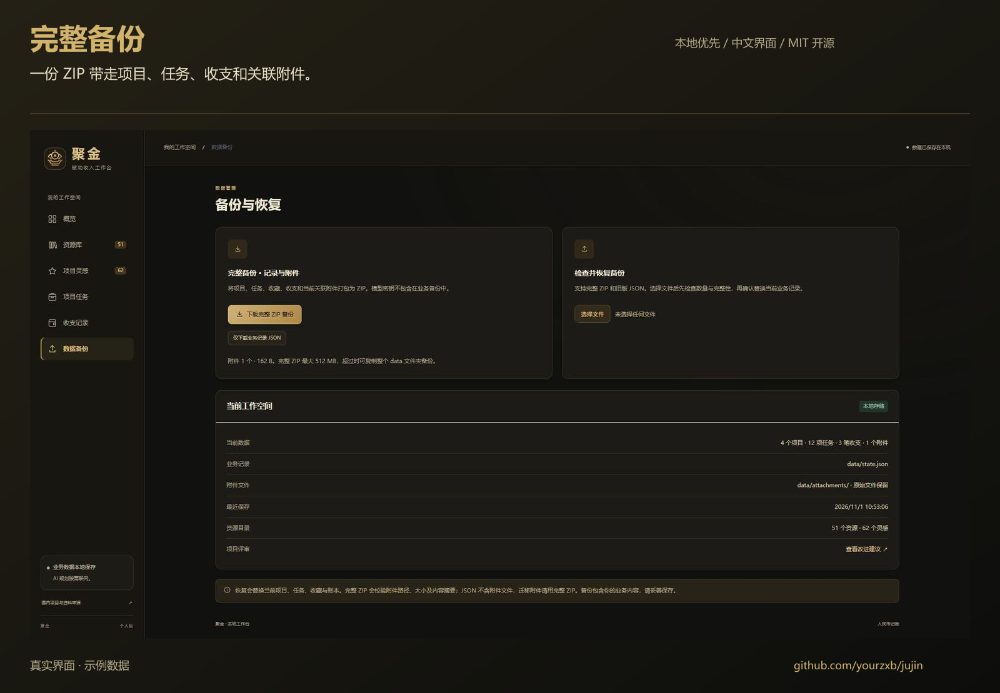

# 聚金 Jujin

**把灵感、行动与收支，放在一个工作台。**

[](https://github.com/yourzxb/jujin/actions/workflows/test.yml) · [MIT 开源](LICENSE) · Node.js 22+ · 无第三方运行依赖

一个中文、暗金主题的本地副业经营工作台，适合管理公众号、小程序、教育内容和数字产品等项目。

[快速开始](#快速开始) · [28 秒使用演示](#28-秒使用演示) · [界面预览](#界面预览) · [使用说明](使用说明.md)



## 28 秒使用演示

搜索与收藏资源 → 创建项目 → 添加并完成任务 → 记录收支和附件 → 导出完整备份。



演示使用独立的示例项目和金额。实际业务数据保存在本机；动画未调用付费模型。需要静态版本可查看[图文上手指南](docs/QUICKSTART.md)。

## 快速开始

安装 Node.js 22 或更新版本，然后执行：

```sh
git clone https://github.com/yourzxb/jujin.git
cd jujin
node server.mjs
```

打开 **http://127.0.0.1:8765/** 即可使用。无需 `npm install`，基础项目管理和记账无需模型密钥。

Windows 也可以下载源码后，双击 `启动聚金.cmd`；使用 `停止聚金.cmd` 关闭后台。首次运行自动创建空白业务数据。

需要 AI 拆解任务时，在“项目任务 → 模型设置”填写第三方 OpenAI 兼容接口、模型名称与密钥。生成前配置即可，调用费用按服务商规则计算。

## 功能

- 资源库：真实 GitHub 仓库、国内平台与官方文档，支持搜索、分类和收藏。
- 项目灵感：交付物、验证步骤、维护成本与来源，独立于资源目录。
- 项目任务：手动管理进度；通过第三方 OpenAI 兼容接口生成任务草案，确认后加入。
- 收支账本：人民币精确到分，长备注、编辑记录和多个附件。
- 数据迁移：完整 ZIP 备份包含附件，兼容旧 JSON；恢复前预览与完整性校验。
- 目录维护：增量合并、去重、星数快照和成对热更新。每日检索需要另外配置运行环境的自动化，下载本仓库不会自动创建定时任务。

## 界面预览

点击图片可查看大图。全部画面均来自真实界面，业务记录为演示数据。

| 资源库：检索与收藏 | 项目灵感：验证与交付 |
| --- | --- |
| [](docs/images/resources.jpg) | [](docs/images/inspirations.jpg) |

| 项目任务：行动与进度 | 收支记录：备注与附件 |
| --- | --- |
| [](docs/images/projects.jpg) | [](docs/images/ledger.jpg) |

<details>
<summary>查看完整备份界面</summary>



</details>

## 数据与限制

业务数据位于 `data/`，运行日志位于 `logs/`；均不应提交到 GitHub。附件每个最多 50 MiB，每笔最多 10 个、合计 200 MiB。完整 ZIP 最大 512 MiB，业务 JSON 最大约 5 MiB。数据量超限时，先停止服务再复制整个 `data/` 目录。

模型密钥明文保存在本机 `data/ai-config.json`，不会通过配置接口回显，也不会进入业务 ZIP/JSON 备份。备份没有加密，请保存在你信任的位置。此版本适合单机个人使用，未提供公网多用户认证。

## 开发与验证

```sh
node --test tests/*.test.mjs
node scripts/build-resource-directory.mjs
node scripts/build-idea-guide.mjs
```

测试使用隔离目录和模拟模型，不会读写真实账本或调用付费模型。目录生成会保留每日来源文件，浏览器刷新时接收完整的新目录；无效或未写完的目录继续使用上一版。

- [使用说明](使用说明.md)
- [每日资源维护](docs/AUTOMATION.md)
- [安全与数据边界](SECURITY.md)
- [贡献说明](CONTRIBUTING.md)
- [第三方来源](THIRD_PARTY_NOTICES.md)

## 许可

聚金应用代码采用 [MIT](LICENSE) 许可证。目录所链接的第三方软件、素材、平台和模型服务保留各自许可。项目灵感是待验证的产品方向，不代表已验证收入。

如果聚金对你有帮助，欢迎点一个 Star，或通过 [Issues](https://github.com/yourzxb/jujin/issues) 分享使用反馈。
