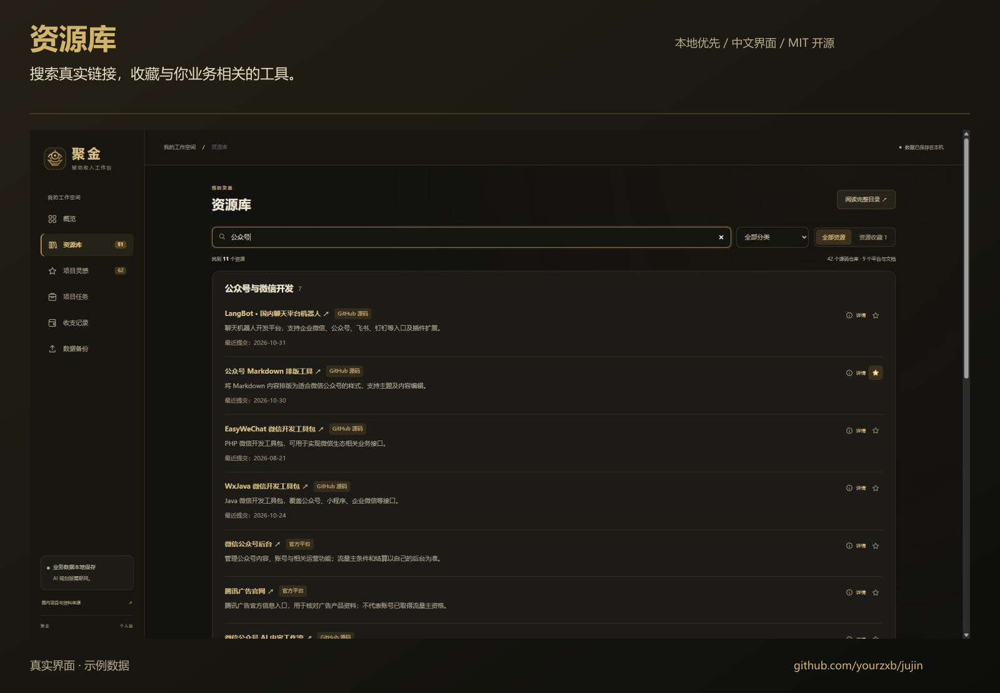
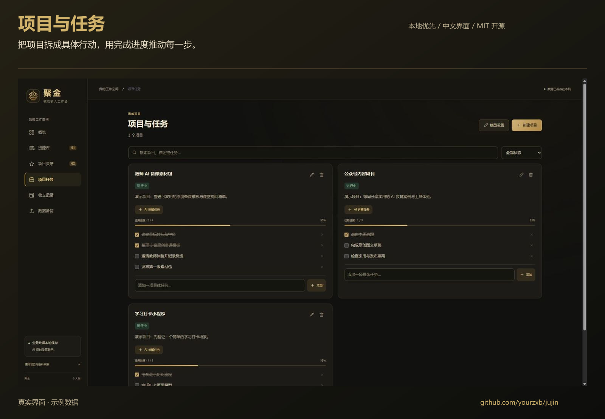
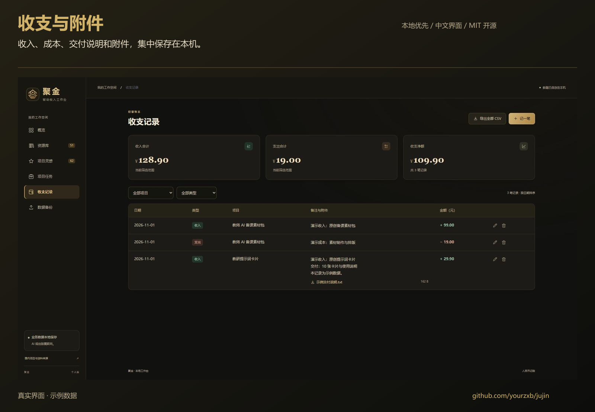
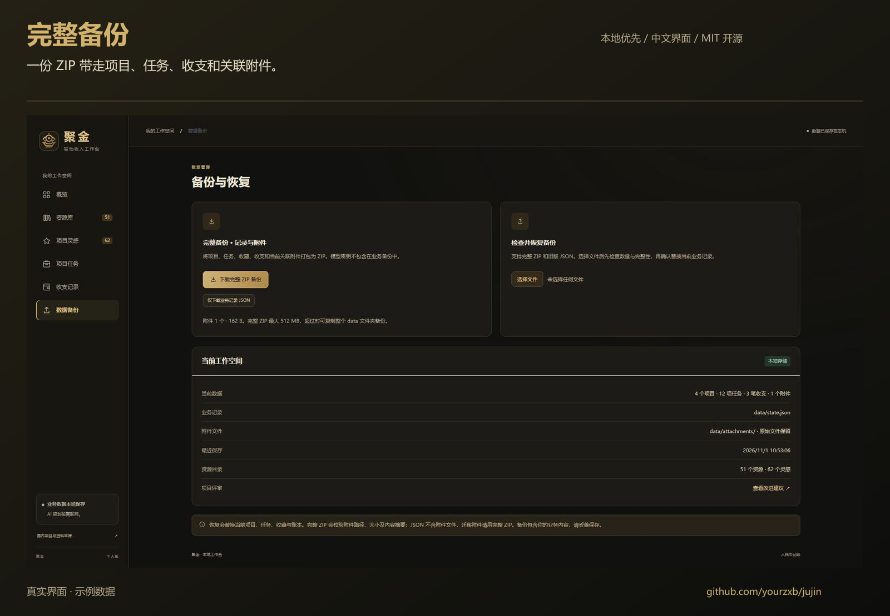

# 聚金图文上手指南

本文使用演示项目和示例金额，不代表实际收入。所有界面均在独立演示工作空间中拍摄。

## 1. 找到可以使用的资源

进入“资源库”，输入业务关键词，例如“公众号”。查看资源名称、用途和真实链接，再点击星标收藏。

## 2. 把方向变成具体项目

进入“项目任务”，点击“新建项目”。填写项目名称、描述和当前状态，按需关联资源或灵感。

在项目卡片下方添加可执行的小任务，完成后勾选，进度会同步更新。需要 AI 生成任务草案时，先配置自己的第三方 OpenAI 兼容接口；草案确认后才加入项目。

## 3. 记录投入、收入与交付附件

进入“收支记录”，点击“记一笔”。选择类型、日期、金额和项目，填写备注；需要保存交付材料时选择附件，然后点击“保存记录与附件”。

支持文档、图片和压缩包。单个附件最大 50 MB，每笔最多 10 个、合计 200 MB；备注支持换行并随内容增高。

## 4. 定期保存完整备份

进入“数据备份”，点击“下载完整 ZIP 备份”。ZIP 包含业务记录与当前关联附件，不包含模型密钥。恢复时先检查数量与完整性，再决定是否替换当前业务记录。

## 界面演示说明

- 录制版本：聚金 1.1.0；拍摄日期：2026-11-01（北京时间）。
- 动图约 28 秒，循环播放；此页面是无需动画的静态替代版本。
- 截图和动画中的项目、金额及附件均为特意创建的示例数据，未公开个人账本和密钥。
- 基础功能无需付费模型；本次动图没有演示或调用模型生成接口。

[返回项目首页](../README.md)
